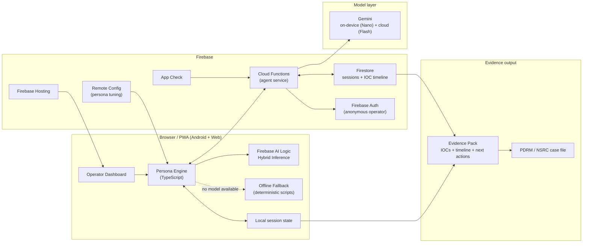

# LAYAN — the anti-scam persona agent, with hybrid inference

> **Most people block scam calls. Blocking ends the interaction — and gives the
> police nothing. LAYAN does the opposite: it keeps the scammer on the line
> and turns the call into evidence.**

LAYAN is an AI agent that engages a reported scam caller instead of blocking
them. It stalls, asks naive questions, and extracts the mule accounts, phone
numbers, payment channels and pressure tactics out of every exchange. The
session ends in a structured evidence pack ready for a police report or a
bank's fraud desk.

The scammer side is a **scripted simulator** of real Malaysian scam archetypes —
fully offline, deterministic under a seed, and safe to interact with.

---

## Why hybrid inference

The split is not a demo trick. It is the actual engineering requirement:

| Path | Where it runs | Why |
|---|---|---|
| **Persona reply** | **On-device** (Gemini Nano via Firebase AI Logic), falling back to the cloud model, falling back to a deterministic script | The scammer-facing persona must never stall because a network dropped — that is exactly when the scammer pushes hardest. |
| **Evidence pack** | **Cloud** (Firestore + Cloud Functions) | The evidence has to be durable, auditable, and shareable across devices and agencies. If the phone dies mid-engagement, the cloud still has the session and the indicator timeline. |

So the reply path is deliberately resilient and local-first, and the record
path is deliberately durable and cloud-first.

```
on-device model  ->  cloud model  ->  offline script
```

The UI tells you honestly which one produced each reply.

---

## Architecture



### Component responsibilities

| Component | Responsibility | Runtime |
|---|---|---|
| Operator Dashboard | Live transcript, indicator timeline, controls | Web / Android (PWA) |
| Persona Engine | Archetype selection, script state machine, turn taking | TypeScript, shared |
| Reply Generator | Natural-language persona reply | Firebase AI Logic hybrid |
| Offline Fallback | Seeded scripted replies when no model is available | Local, deterministic |
| Local state | Session state + indicator cache | In-memory (per session) |
| Cloud Functions | Shared agent service, cross-device session sync | Node, behind Firebase |
| Firestore | Durable sessions, indicator timeline, audit trail | Firebase |
| Remote Config | Persona tone and archetype tuning without a new build | Firebase |

---

## The persona

**Puan Rina**, 54, a retired school teacher from Kepala Batas, Penang. Polite,
patient, slightly hard of hearing, and endlessly curious about banking
details. She believes the caller is a real government or company
representative and wants to cooperate — but she is slow, asks for details to be
repeated, and keeps the call going far longer than expected.

The archetype library matches her to the script: Pos Laju customs fee, LHDN
tax refund, romance, paid-task job.

---

## Scam archetypes

| Archetype | Fingerprint | What it leaks |
|---|---|---|
| Pos Laju Customs Fee | `PARCEL-CUSTOMS` | bank account, account name, office line, DuitNow number |
| LHDN Tax Refund / Freeze | `TAX-REFUND` | bank account, account name, hotline, TnG number |
| Romance / Love Scam | `ROMANCE-CRUEL` | agent account, Western Union code, direct phone |
| Paid-Task Job Scam | `PAID-TASK` | merchant account, GrabPay number, second account |

---

## What gets harvested

Every inbound scammer message passes through an indicator extractor that
pattern-matches and confidence-scores candidates:

- **bank account** + the bank it was named against
- **phone number**
- **account name**
- **payment channel** (DuitNow, Touch 'n Go, GrabPay, Western Union)
- **amount demanded**
- **pressure tactic**

The session ends in an evidence pack: the script fingerprint, a full
transcript, a deduplicated indicator table, the pressure-tactic timeline, and
recommended next actions (flag on SemakMule, dial 997 for NSRC, file at the
nearest balai).

---

## Run it locally

```bash
npm install
cp .env.example .env    # fill in the Firebase web app config
npm run dev
```

## Deploy it

```bash
npm run build
npx firebase-tools deploy --only hosting,firestore:rules
```

## Tests

The engine is pure and deterministic, so the interesting assertions are about
IOC extraction and session invariants:

```bash
npm run typecheck
```

---

## Safety

- The bundled scammer side is a **scripted simulator**. It makes no telephony
  calls and contacts no real numbers.
- All extraction is local. In the cloud path, session content is stored in the
  operator's own Firebase project; Firebase Auth provides identity and
  project-level access control; Firestore rules scope every session to its
  owner.
- Connecting the engine to real telephony is your decision and your legal
  responsibility — make sure you have the legal basis to do so in your
  jurisdiction.

## License

MIT
